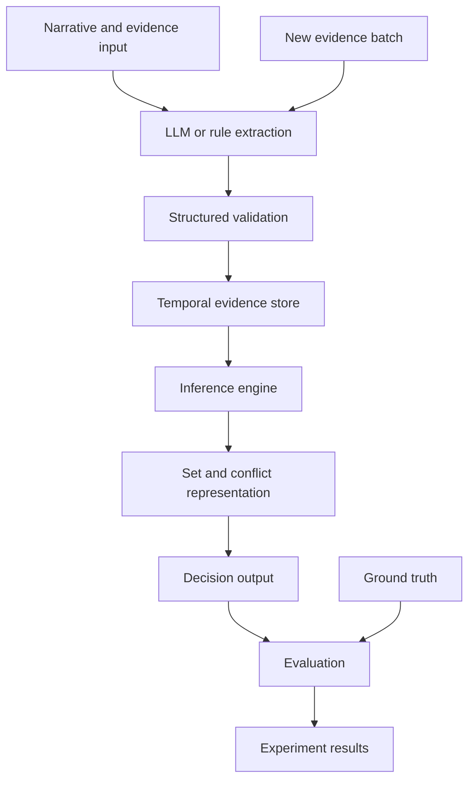
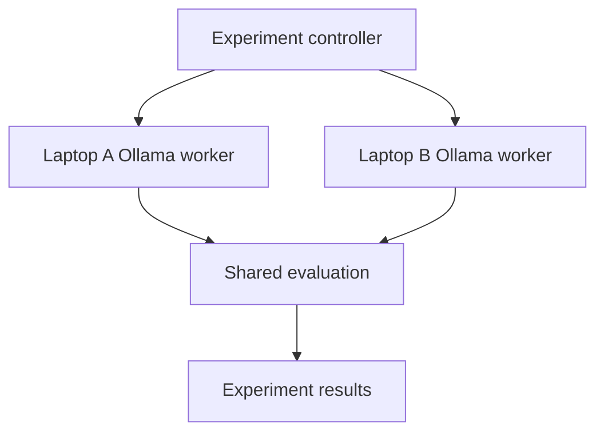

# Phương pháp EADIS

## Why và What

Một quyết định suy ra từ narrative phụ thuộc vào bằng chứng được quan sát và các điều kiện để diễn giải bằng chứng đó. EADIS dùng narrative tổng hợp có danh sách lựa chọn hữu hạn, từ điển sự kiện, ID nguồn và thứ tự nhận nguồn đã biết.

## Math và How

Với miền phương án hữu hạn Ω, mỗi claim selected(x) giao tập hiện tại với {x}, còn excluded(x) loại x. Tập nghiệm sau n claim là giao các tập tương thích. Khi tập rỗng, engine ghi xung đột và báo thêm Ω như một fallback bảo thủ. Khi tập có nhiều phần tử, kết quả chưa được nhận dạng điểm. Đây là bài tập về tập nhận dạng hữu hạn theo các ràng buộc đã chấp nhận. Xác suất của từng lựa chọn cần mô hình và giả định bổ sung.

Quan hệ before là đồ thị có hướng. Khi thêm cạnh u → v, nối mọi đỉnh đi được đến u với mọi đỉnh tới được từ v, kể cả u và v. Một cặp phản xạ trong bao đóng biểu thị chu trình. Quan hệ thời gian và ràng buộc lựa chọn hiện được tính riêng. Baseline tính lại lọc Ω theo toàn bộ claim và lặp bao đóng đến điểm cố định.

Bản ghi bằng chứng giữ loại claim, đối tượng, ID nguồn và khoảng ký tự của quote. Quote trùng lặp trong một nguồn lấy vị trí xuất hiện đầu tiên. Khử trùng lặp dùng toàn bộ bản ghi để giữ provenance từ các nguồn riêng. Kiểm tra cấu trúc xác nhận quote, nguồn và thực thể thuộc từ điển. Precision theo nhãn đo thêm phần tương thích ngữ nghĩa. Mỗi bản ghi được dùng như ràng buộc cứng sau kiểm tra cấu trúc, nên claim gán sai ngữ nghĩa có thể thu hẹp tập sai.

## Code

`eadis.schema` định nghĩa input công khai, extraction và nhãn. `eadis.extraction` chứa regex, mock JSON và Ollama structured output. `eadis.inference` xác minh nguồn, tích lũy ràng buộc và tính lại độc lập. `eadis.runner` thực thi theo từng tiền tố, mở nhãn sau dự đoán và lưu báo cáo. `eadis.evaluation` tính chỉ số theo bước và tổng hợp theo điều kiện.

## Experiment

- So sánh luật với Ollama theo cùng batch. Phân tích hành động điểm từ extractor, tập khả dĩ, F1 evidence, F1 thời gian, cờ xung đột và tỷ lệ quote hợp lệ. Hai tập rỗng có F1 bằng 1. Với mẫu số không xác định, span rate và coverage được báo là null.
- Dùng các cặp cùng họ để so sánh paraphrase và nhiễu. Báo cáo lỗi trích xuất cùng số bước tổng cộng. Lỗi tiền tố làm các bước tiếp theo của case mất khả năng đánh giá.
- So sánh agreement giữa cập nhật và tính lại sau mỗi batch. Timing chỉ bao gồm cập nhật hoặc tính lại và xuất kết quả của engine, tính bằng ns. Chạy lặp trên cùng máy và đảo thứ tự giữa các lần đo trong nghiên cứu hiệu năng tiếp theo.
- Khi mở rộng benchmark, khóa nhãn và mô hình trước khi chạy tập cuối. Dùng bootstrap ghép cặp theo họ narrative cho khoảng tin cậy khi có đủ họ độc lập. Báo cáo cấu hình máy và phiên bản Ollama cạnh kết quả. Fixture hiện tại phục vụ thống kê mô tả.

## Reflection

Từ điển định danh được cung cấp trước nhằm kiểm soát sai số chuẩn hóa và giúp quan sát lỗi evidence. Nhiệm vụ nhận diện actor, tình huống, option và sự kiện hoàn toàn từ văn bản cần dữ liệu và giao thức riêng. Trích xuất chỉ nhìn batch hiện tại, nên tham chiếu chéo giữa các batch là một ca mở rộng. Cơ chế hiện tại thêm bằng chứng và coi các nguồn như ràng buộc ngang nhau. Hiệu chỉnh độ tin nguồn, rút lại bằng chứng, reasoning có điều kiện thời gian và các giả định nhận dạng của ETVM-PI thuộc giai đoạn nghiên cứu tiếp theo.
